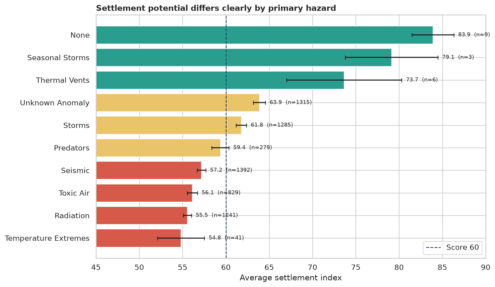
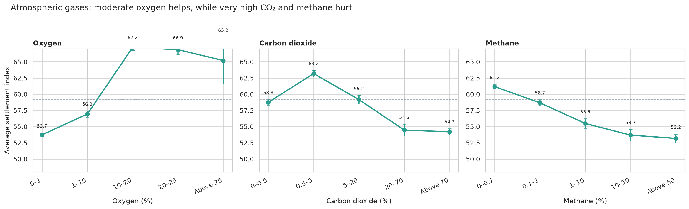
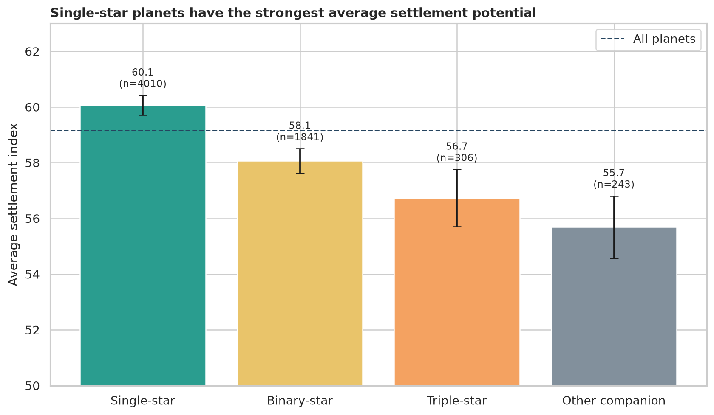
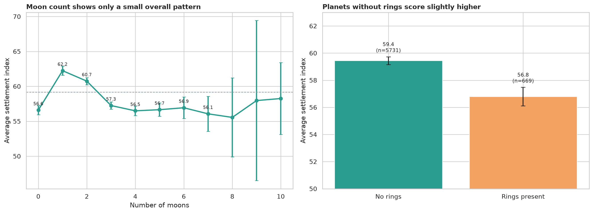
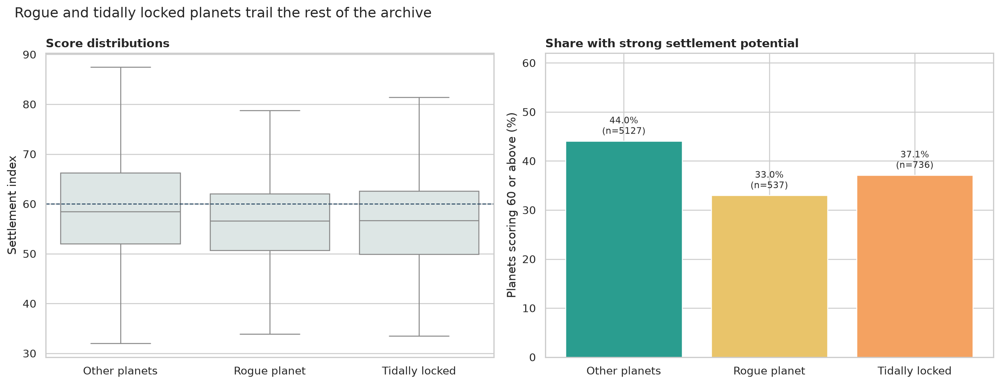
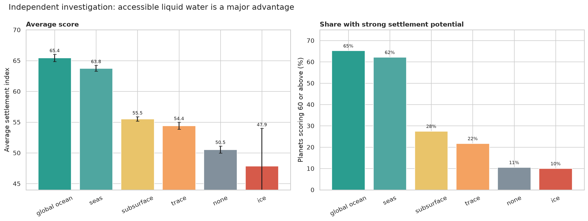

# OLYMPUS TECH 4.0   Part Two: Planetary Archive Analysis

**Team:** The gentlemen  

## Overview

The archive suggests that a planet's environment matters much more than any single isolated feature. The clearest advantages are **accessible liquid water**, a **manageable atmosphere**, and the absence of severe hazards. Worlds with no primary hazard have the highest scores, while thermal extremes and high radiation are among the most difficult conditions.

The main findings are:

- Hazard-free worlds average **83.9**, the highest result in the archive.
- Oxygen is helpful in moderate amounts, while very high carbon dioxide and methane are linked to lower scores.
- Planets around single stars average **60.1**, ahead of binary and triple-star systems.
- Rings are linked to a small drop in settlement potential; moon count has only a weak overall relationship.
- Rogue and tidally locked planets both score below other planets.
- Our independent investigation finds that global oceans and surface seas provide one of the strongest advantages in the archive.

---

## Q1. How does the recorded primary hazard relate to settlement potential?

  

The primary hazard has a clear relationship with settlement potential.

### Highest-scoring hazard groups

- **None**: average score **83.9** (100% score 60 or above; 9 planets)
- **Seasonal Storms**: average score **79.1** (100% score 60 or above; 3 planets)
- **Thermal Vents**: average score **73.7** (100% score 60 or above; 6 planets)
- **Unknown Anomaly**: average score **63.9** (56% score 60 or above; 1,315 planets)

### Lowest-scoring hazard groups

- **Temperature Extremes**: average score **54.8** (29% score 60 or above; 41 planets)
- **Radiation**: average score **55.5** (30% score 60 or above; 1,241 planets)
- **Toxic Air**: average score **56.1** (31% score 60 or above; 829 planets)
- **Seismic**: average score **57.2** (37% score 60 or above; 1,392 planets)

Worlds marked **“none”** stand out with an average score of **83.9**. This is sensible: fewer major dangers mean less protection, engineering and medical support would be needed.

The weakest groups are planets affected by **temperature extremes**, **radiation**, and **toxic air**. Seasonal storms perform better than continuous or severe storms, suggesting that a hazard can be manageable when it is predictable and temporary.

**Answer:** Hazard-free and relatively manageable environments have the best settlement potential. Extreme temperatures, radiation and toxic atmospheres are associated with lower scores.

---

## Q2. How do atmospheric gas levels relate to settlement potential?

  

The atmosphere does not follow a simple “more is better” rule.

### Oxygen

- Planets with **20–25% oxygen** average **66.9**.
- Planets with only **0–1% oxygen** average **53.7**.
- Oxygen above 25% does not produce a further large improvement.

This suggests that a moderate, breathable-looking oxygen range is preferable to almost no oxygen.

### Carbon dioxide

- The highest CO₂ band, **above 70%**, averages **54.2**.
- Low to moderate CO₂ groups generally perform better.

Very high carbon dioxide is therefore linked to less favourable conditions, which is consistent with heat and breathing problems.

### Methane

- Methane above 50% averages **53.2**.
- Trace and low-methane atmospheres score better overall.

**Answer:** Moderate oxygen is associated with better settlement potential. Very high carbon dioxide or methane is associated with lower potential. The overall mix matters more than any gas by itself.

---

## Q3. How does stellar multiplicity relate to settlement potential?

  

The planets were grouped into single-star, binary-star, triple-star and other companion systems.

| Star system | Planets | Average score | Score 60+ |
|---|---:|---:|---:|
| Single-star | 4,010 | 60.1 | 45% |
| Binary-star | 1,841 | 58.1 | 39% |
| Triple-star | 306 | 56.7 | 33% |
| Other companion | 243 | 55.7 | 29% |

Single-star planets have the strongest average result. Multiple-star systems may experience more complicated or changing energy conditions, but this dataset alone cannot prove that this is the cause.

**Answer:** Planets associated with single stars have the highest average settlement potential. Binary, triple and other companion systems score lower, although the difference is moderate rather than overwhelming.

---

## Q4. How do moons and rings relate to settlement potential?

  

### Number of moons

Planets with **one moon** have the highest well-supported average, at **62.2**, followed by two-moon planets at **60.7**. Planets with no moons average **56.6**.

However, the overall relationship between moon count and settlement score is weak. The correlation is **-0.09**, which is close to zero. After two moons, the scores move up and down rather than following a steady pattern.

The highest moon counts also contain relatively few planets, so their averages should not be treated as firm evidence.

### Rings

- Planets **without rings** average **59.4**.
- Planets **with rings** average **56.8**.

This is a difference of **2.7 points**. It is noticeable but much smaller than the differences associated with hazards or water.

**Answer:** One or two moons are associated with higher scores in this archive, but moon count alone is not a reliable guide because there is no steady trend. Planets without rings score slightly higher than ringed planets, but rings should be treated as a secondary clue rather than a deciding factor.

---

## Q5. How do rogue and tidally locked planets compare with other planets?

  

| Planet group | Planets | Average score | Score 60+ |
|---|---:|---:|---:|
| Other planets | 5,127 | 59.8 | 44.0% |
| Rogue planets | 537 | 56.7 | 33.0% |
| Tidally locked planets | 736 | 56.6 | 37.1% |

Other planets have the best average score and the largest share scoring 60 or above. Rogue planets lack a normal host-star energy source, while tidally locked worlds may face a hot permanent day side and a cold permanent night side. Both conditions can make settlement more difficult.

Some rogue and tidally locked planets still receive good scores, so neither label should be used as an automatic rejection.

**Answer:** Rogue and tidally locked planets are less promising on average than other planets, but there are exceptions in both groups.

---

## Independent investigation

### Question: How strongly does water availability relate to settlement potential?

This question is separate from the five provided questions. We compared planets with global oceans, seas, subsurface water, traces, ice and no recorded water.

  

### Findings

- **Global ocean:** average **65.4**; **65%** score 60 or above.
- **Seas:** average **63.8**; **62%** score 60 or above.
- **No water:** average **50.5**; **11%** score 60 or above.
- **Surface ice:** average **47.9**; **10%** score 60 or above.

The difference between global-ocean and no-water planets is **14.9 points**. Surface seas and oceans are associated with much stronger settlement potential than no water, trace water or ice alone.

This does not mean water is the only requirement. Some water-rich worlds are still too hot, irradiated or stormy. However, accessible liquid water appears to be one of the most useful first screening criteria in the archive.

**Conclusion:** Our hypothesis is supported. Planets with accessible surface water are substantially more promising for settlement than dry or frozen worlds.

---

## Overall conclusion

The most promising worlds combine several advantages:

1. No severe primary hazard.
2. Accessible surface water.
3. Moderate oxygen without an extreme carbon-dioxide or methane atmosphere.
4. A relatively stable star system.
5. No major rogue-planet or tidal-locking penalty.

No single feature guarantees a good settlement score. The strongest candidates are planets where several favourable conditions occur together.